# Selector graph

Every selector in `src/` — 210 across 36 files. An arrow `A --> B` means **A reads B**
(B is one of A's reselect inputs, or A calls it). A dotted arrow is the Wound Modifier Dice Group that
`createDicePoolSelector` appends to every dice pool not built with `excludeWoundMod: true`.

Generated from the TypeScript sources by symbol resolution; regenerate it rather than hand-editing when selectors change.

## File overview

One node per selector file; an arrow means some selector in the first file reads one in the second.

```mermaid
flowchart LR
  f_services_improvements_improvementSelectors["ImprovementsSelectors<br/><small>services/improvements/improvementSelectors.ts · 4</small>"]
  f_services_dice_state_diceRoller_selector["(module-scope selectors)<br/><small>services/dice/state/diceRoller.selector.ts · 9</small>"]
  f_services_initiativeTracker_initiativeTrackerSlice_selectors["(module-scope selectors)<br/><small>services/initiativeTracker/initiativeTrackerSlice.selectors.ts · 4</small>"]
  f_state_runner_skills_skills_selector["SkillsSelectors<br/><small>state/runner/skills/skills.selector.ts · 18</small>"]
  f_state_runner_dicePool_contactPools_selector["ContactPoolSelectors<br/><small>state/runner/dicePool/contactPools.selector.ts · 4</small>"]
  f_state_runner_dicePool_magicPools_selector["MagicPoolSelectors<br/><small>state/runner/dicePool/magicPools.selector.ts · 10</small>"]
  f_state_runner_dicePool_combatPools_selector["CombatPoolSelectors<br/><small>state/runner/dicePool/combatPools.selector.ts · 26</small>"]
  f_state_runner_dicePool_skillPools_selector["SkillPoolSelectors<br/><small>state/runner/dicePool/skillPools.selector.ts · 6</small>"]
  f_state_runner_gameState_matrix_matrix_selector["MatrixSelectors<br/><small>state/runner/gameState/matrix/matrix.selector.ts · 4</small>"]
  f_state_runner_complexForms_complexForms_selector["ComplexFormsSelectors<br/><small>state/runner/complexForms/complexForms.selector.ts · 3</small>"]
  f_state_runner_edge_edge_selector["EdgeSelectors<br/><small>state/runner/edge/edge.selector.ts · 2</small>"]
  f_state_runner_extendedTests_extendedTests_selector["ExtendedTestsSelectors<br/><small>state/runner/extendedTests/extendedTests.selector.ts · 1</small>"]
  f_state_runner_viewerSelector["ViewerStateSelectors<br/><small>state/runner/viewerSelector.ts · 4</small>"]
  f_state_runner_profile_profile_selector["ProfileSelectors<br/><small>state/runner/profile/profile.selector.ts · 4</small>"]
  f_state_runner_karma_karma_selector["KarmaSelectors<br/><small>state/runner/karma/karma.selector.ts · 4</small>"]
  f_state_runner_notes_notes_selector["NotesSelectors<br/><small>state/runner/notes/notes.selector.ts · 1</small>"]
  f_state_runner_biology_biology_selector["BiologySelectors<br/><small>state/runner/biology/biology.selector.ts · 6</small>"]
  f_state_runner_reputation_reputation_selector["ReputationSelectors<br/><small>state/runner/reputation/reputation.selector.ts · 7</small>"]
  f_state_runner_houseRules_houseRules_selector["HouseRulesSelectors<br/><small>state/runner/houseRules/houseRules.selector.ts · 1</small>"]
  f_state_runner_qualities_qualities_selector["QualitiesSelectors<br/><small>state/runner/qualities/qualities.selector.ts · 1</small>"]
  f_state_runner_tradition_tradition_selector["TraditionSelectors<br/><small>state/runner/tradition/tradition.selector.ts · 1</small>"]
  f_state_runner_items_items_selector["ItemSelectors<br/><small>state/runner/items/items.selector.ts · 33</small>"]
  f_state_runner_contacts_contacts_selector["ContactsSelectors<br/><small>state/runner/contacts/contacts.selector.ts · 1</small>"]
  f_state_runner_spirits_spirits_selector["SpiritsSelectors<br/><small>state/runner/spirits/spirits.selector.ts · 1</small>"]
  f_state_runner_initiative_initiative_selector["InitiativeSelectors<br/><small>state/runner/initiative/initiative.selector.ts · 4</small>"]
  f_state_runner_meta_meta_selector["MetaSelectors<br/><small>state/runner/meta/meta.selector.ts · 1</small>"]
  f_state_runner_damage_damage_selector["DamageSelectors<br/><small>state/runner/damage/damage.selector.ts · 9</small>"]
  f_state_runner_nuyen_nuyen_selector["NuyenSelectors<br/><small>state/runner/nuyen/nuyen.selector.ts · 3</small>"]
  f_state_runner_powers_powers_selector["PowersSelectors<br/><small>state/runner/powers/powers.selector.ts · 2</small>"]
  f_state_runner_attributes_attributes_selector["AttrSelectors<br/><small>state/runner/attributes/attributes.selector.ts · 18</small>"]
  f_state_runner_spells_spells_selector["SpellsSelectors<br/><small>state/runner/spells/spells.selector.ts · 1</small>"]
  f_state_runner_lifestyle_lifestyle_selector["LifestyleSelectors<br/><small>state/runner/lifestyle/lifestyle.selector.ts · 8</small>"]
  f_state_runner_gameEffects_gameEffects_selector["SourcedGameEffectSelectors<br/><small>state/runner/gameEffects/gameEffects.selector.ts · 2</small>"]
  f_state_runner_gameEffects_dicePoolMods_selector["DicePoolModSelectors<br/><small>state/runner/gameEffects/dicePoolMods.selector.ts · 2</small>"]
  f_state_runner_sprites_sprites_selector["SpriteSelectors<br/><small>state/runner/sprites/sprites.selector.ts · 4</small>"]
  f_state_builder_builderStore_selectors["BuilderStateSelectors<br/><small>state/builder/builderStore.selectors.ts · 1</small>"]
  f_services_improvements_improvementSelectors --> f_state_runner_attributes_attributes_selector
  f_state_runner_skills_skills_selector --> f_state_runner_viewerSelector
  f_state_runner_skills_skills_selector --> f_state_runner_biology_biology_selector
  f_state_runner_skills_skills_selector --> f_state_runner_gameEffects_gameEffects_selector
  f_state_runner_dicePool_contactPools_selector --> f_state_runner_attributes_attributes_selector
  f_state_runner_dicePool_contactPools_selector --> f_state_runner_skills_skills_selector
  f_state_runner_dicePool_contactPools_selector --> f_state_runner_damage_damage_selector
  f_state_runner_dicePool_magicPools_selector --> f_state_runner_attributes_attributes_selector
  f_state_runner_dicePool_magicPools_selector --> f_state_runner_gameEffects_dicePoolMods_selector
  f_state_runner_dicePool_magicPools_selector --> f_state_runner_skills_skills_selector
  f_state_runner_dicePool_magicPools_selector --> f_state_runner_damage_damage_selector
  f_state_runner_dicePool_combatPools_selector --> f_state_runner_skills_skills_selector
  f_state_runner_dicePool_combatPools_selector --> f_state_runner_gameEffects_dicePoolMods_selector
  f_state_runner_dicePool_combatPools_selector --> f_state_runner_items_items_selector
  f_state_runner_dicePool_combatPools_selector --> f_state_runner_damage_damage_selector
  f_state_runner_dicePool_combatPools_selector --> f_state_runner_attributes_attributes_selector
  f_state_runner_dicePool_skillPools_selector --> f_state_runner_gameEffects_dicePoolMods_selector
  f_state_runner_dicePool_skillPools_selector --> f_state_runner_skills_skills_selector
  f_state_runner_dicePool_skillPools_selector --> f_state_runner_attributes_attributes_selector
  f_state_runner_dicePool_skillPools_selector --> f_state_runner_damage_damage_selector
  f_state_runner_gameState_matrix_matrix_selector --> f_state_runner_viewerSelector
  f_state_runner_complexForms_complexForms_selector --> f_state_runner_viewerSelector
  f_state_runner_complexForms_complexForms_selector --> f_state_runner_biology_biology_selector
  f_state_runner_complexForms_complexForms_selector --> f_state_runner_attributes_attributes_selector
  f_state_runner_edge_edge_selector --> f_state_runner_attributes_attributes_selector
  f_state_runner_edge_edge_selector --> f_state_runner_viewerSelector
  f_state_runner_extendedTests_extendedTests_selector --> f_state_runner_viewerSelector
  f_state_runner_profile_profile_selector --> f_state_runner_viewerSelector
  f_state_runner_karma_karma_selector --> f_state_runner_viewerSelector
  f_state_runner_notes_notes_selector --> f_state_runner_viewerSelector
  f_state_runner_biology_biology_selector --> f_state_runner_viewerSelector
  f_state_runner_reputation_reputation_selector --> f_state_runner_viewerSelector
  f_state_runner_reputation_reputation_selector --> f_state_runner_karma_karma_selector
  f_state_runner_qualities_qualities_selector --> f_state_runner_viewerSelector
  f_state_runner_tradition_tradition_selector --> f_state_runner_viewerSelector
  f_state_runner_items_items_selector --> f_state_runner_viewerSelector
  f_state_runner_contacts_contacts_selector --> f_state_runner_viewerSelector
  f_state_runner_spirits_spirits_selector --> f_state_runner_viewerSelector
  f_state_runner_initiative_initiative_selector --> f_state_runner_viewerSelector
  f_state_runner_meta_meta_selector --> f_state_runner_viewerSelector
  f_state_runner_damage_damage_selector --> f_state_runner_viewerSelector
  f_state_runner_damage_damage_selector --> f_state_runner_attributes_attributes_selector
  f_state_runner_nuyen_nuyen_selector --> f_state_runner_viewerSelector
  f_state_runner_powers_powers_selector --> f_state_runner_viewerSelector
  f_state_runner_attributes_attributes_selector --> f_state_runner_viewerSelector
  f_state_runner_attributes_attributes_selector --> f_state_runner_items_items_selector
  f_state_runner_attributes_attributes_selector --> f_state_runner_gameState_matrix_matrix_selector
  f_state_runner_attributes_attributes_selector --> f_state_runner_gameEffects_gameEffects_selector
  f_state_runner_attributes_attributes_selector --> f_state_runner_biology_biology_selector
  f_state_runner_spells_spells_selector --> f_state_runner_viewerSelector
  f_state_runner_lifestyle_lifestyle_selector --> f_state_runner_viewerSelector
  f_state_runner_gameEffects_gameEffects_selector --> f_state_runner_viewerSelector
  f_state_runner_gameEffects_gameEffects_selector --> f_state_runner_qualities_qualities_selector
  f_state_runner_gameEffects_gameEffects_selector --> f_state_runner_items_items_selector
  f_state_runner_gameEffects_gameEffects_selector --> f_state_runner_spells_spells_selector
  f_state_runner_gameEffects_gameEffects_selector --> f_state_runner_powers_powers_selector
  f_state_runner_gameEffects_dicePoolMods_selector --> f_state_runner_viewerSelector
  f_state_runner_gameEffects_dicePoolMods_selector --> f_state_runner_gameEffects_gameEffects_selector
  f_state_runner_sprites_sprites_selector --> f_state_runner_viewerSelector
  f_state_runner_sprites_sprites_selector --> f_state_runner_biology_biology_selector
  f_state_runner_sprites_sprites_selector --> f_state_runner_attributes_attributes_selector
  f_state_runner_sprites_sprites_selector --> f_state_runner_skills_skills_selector
```

## Selectors by file

Rounded grey nodes are selectors from other files that this file reads.

### services/dice/state/diceRoller.selector

`src/services/dice/state/diceRoller.selector.ts`

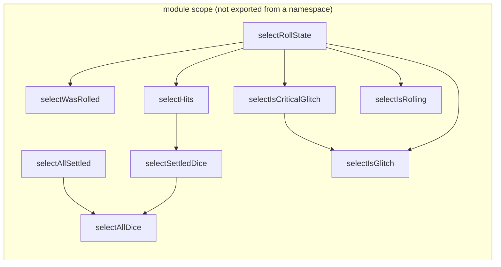

### ImprovementsSelectors

`src/services/improvements/improvementSelectors.ts`

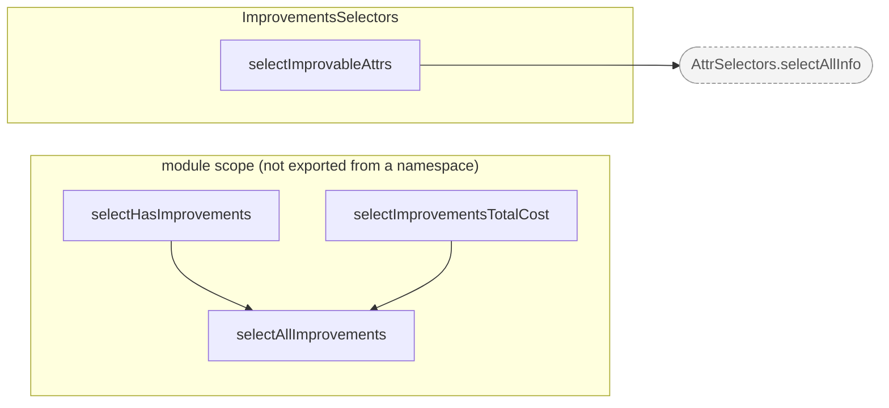

### services/initiativeTracker/initiativeTrackerSlice.selectors

`src/services/initiativeTracker/initiativeTrackerSlice.selectors.ts`

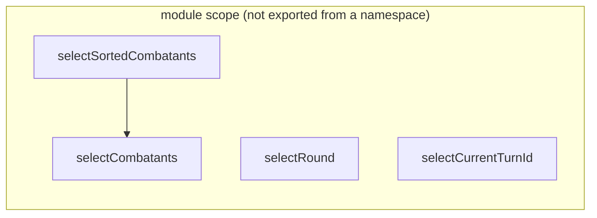

### BuilderStateSelectors

`src/state/builder/builderStore.selectors.ts`

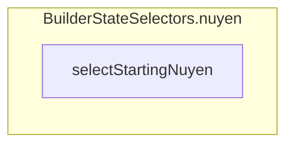

### AttrSelectors

`src/state/runner/attributes/attributes.selector.ts`

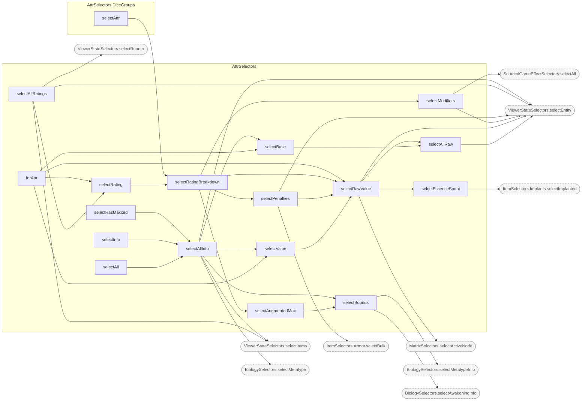

### BiologySelectors

`src/state/runner/biology/biology.selector.ts`

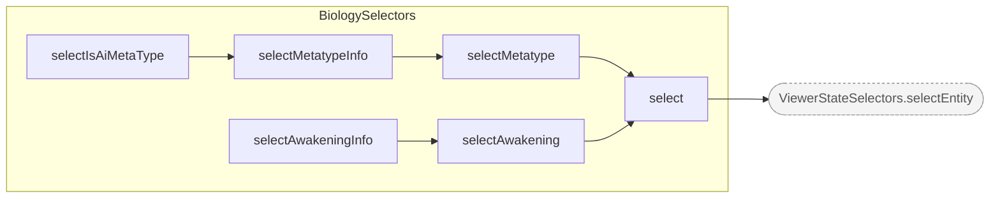

### ComplexFormsSelectors

`src/state/runner/complexForms/complexForms.selector.ts`

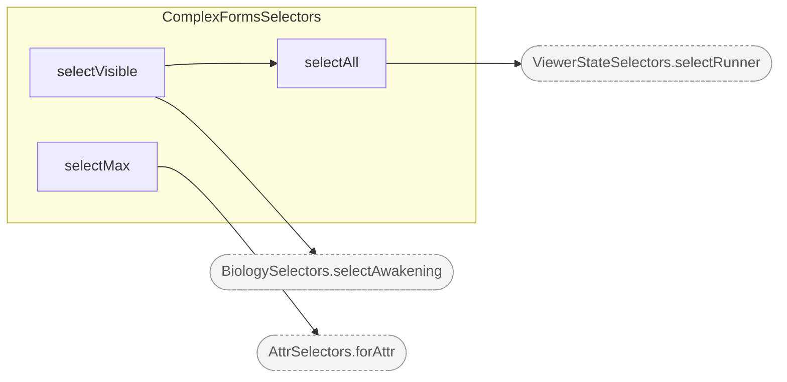

### ContactsSelectors

`src/state/runner/contacts/contacts.selector.ts`

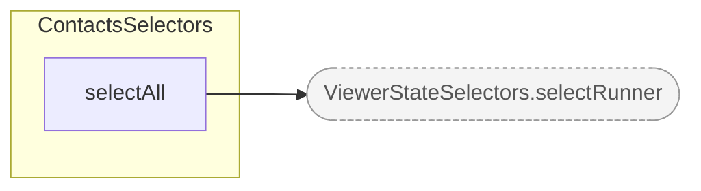

### DamageSelectors

`src/state/runner/damage/damage.selector.ts`

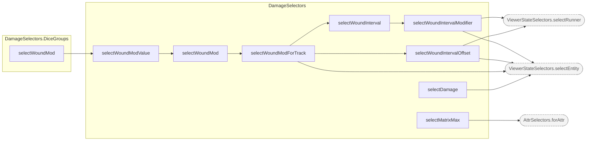

### CombatPoolSelectors

`src/state/runner/dicePool/combatPools.selector.ts`

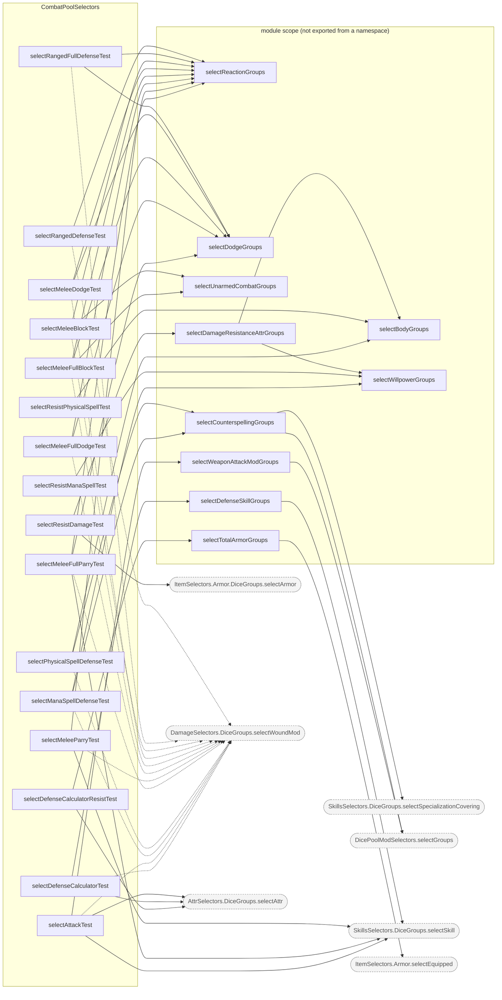

### ContactPoolSelectors

`src/state/runner/dicePool/contactPools.selector.ts`

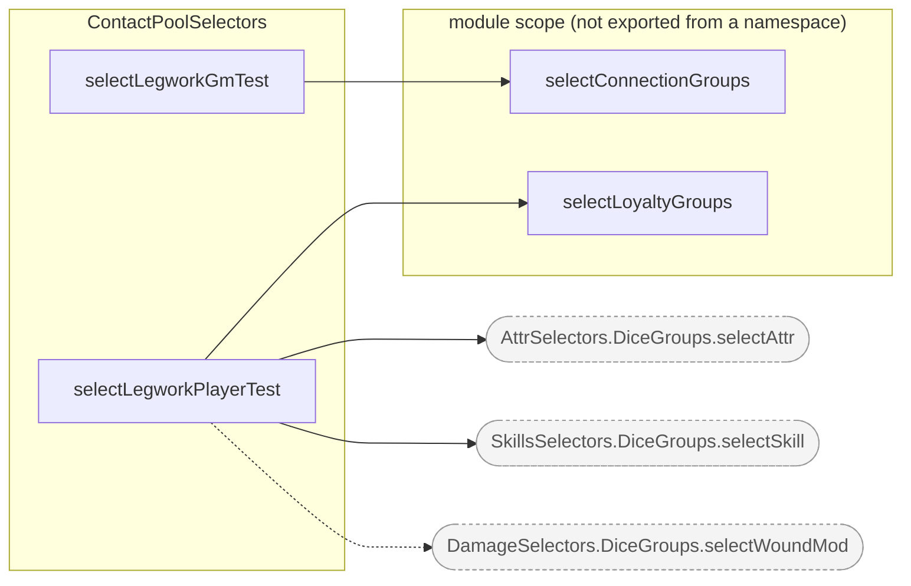

### MagicPoolSelectors

`src/state/runner/dicePool/magicPools.selector.ts`

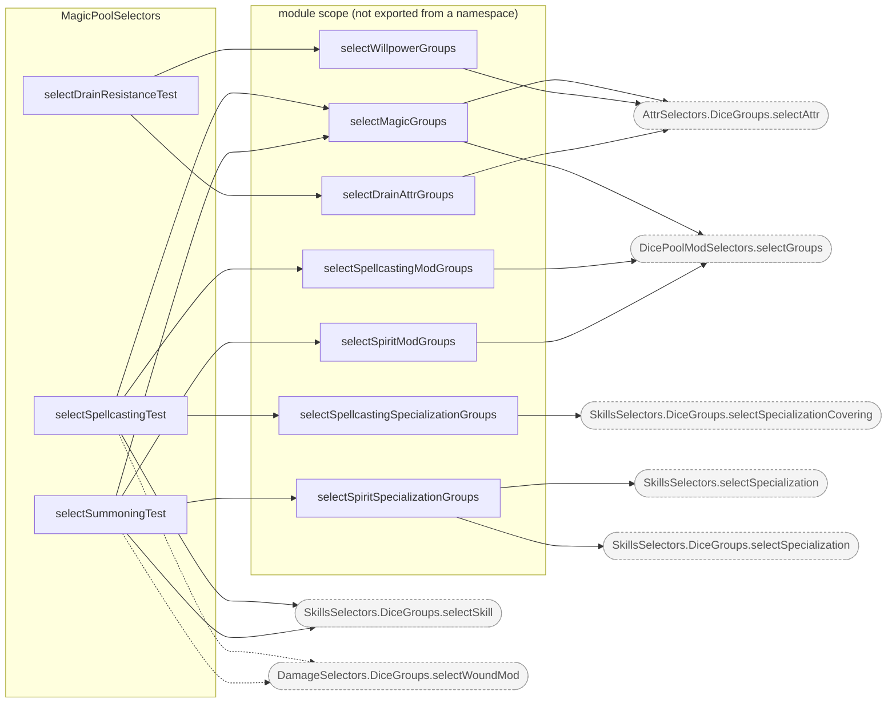

### SkillPoolSelectors

`src/state/runner/dicePool/skillPools.selector.ts`

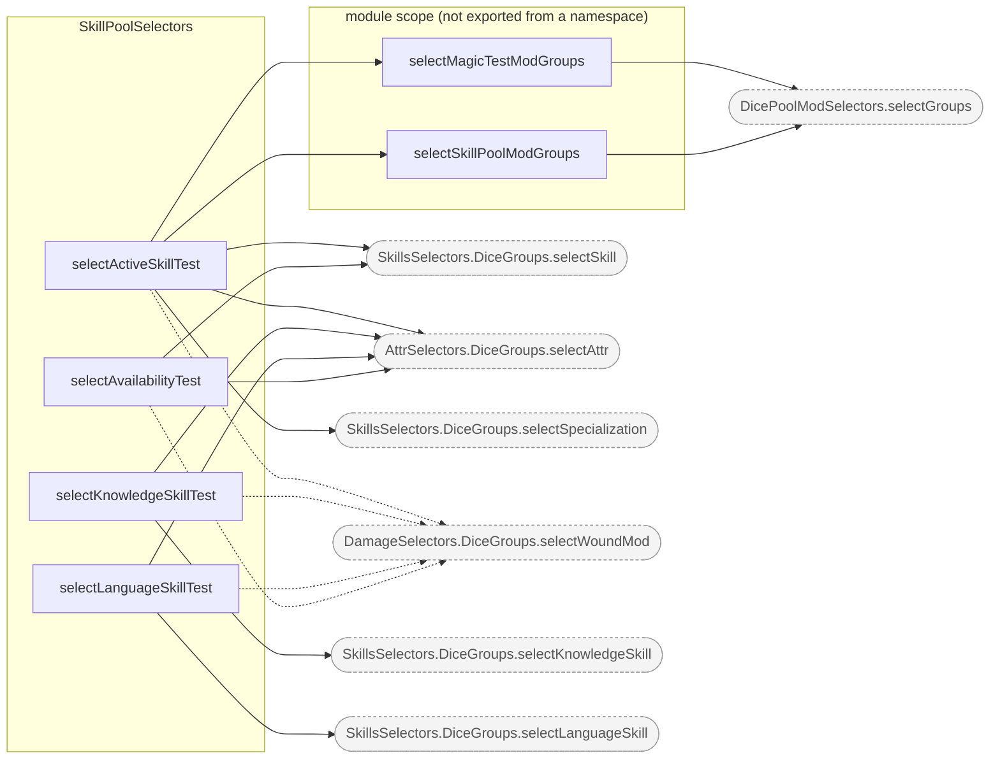

### EdgeSelectors

`src/state/runner/edge/edge.selector.ts`

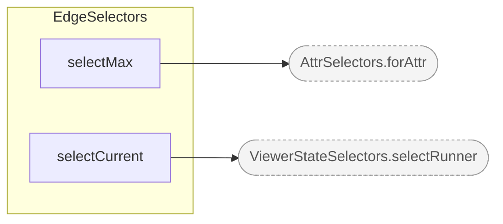

### ExtendedTestsSelectors

`src/state/runner/extendedTests/extendedTests.selector.ts`

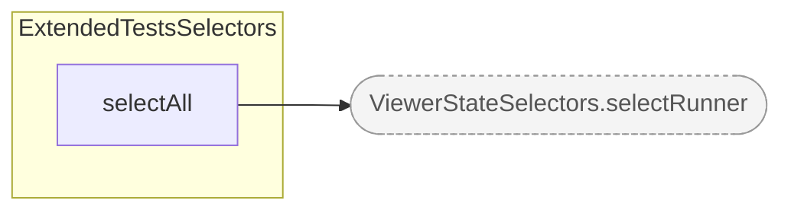

### DicePoolModSelectors

`src/state/runner/gameEffects/dicePoolMods.selector.ts`

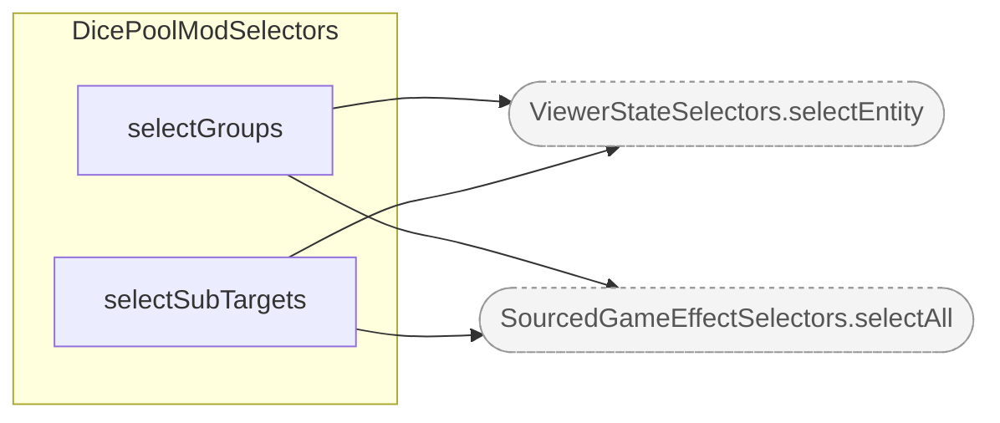

### SourcedGameEffectSelectors

`src/state/runner/gameEffects/gameEffects.selector.ts`

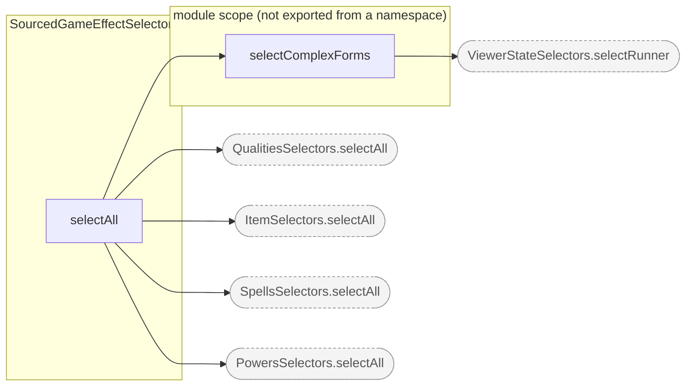

### MatrixSelectors

`src/state/runner/gameState/matrix/matrix.selector.ts`

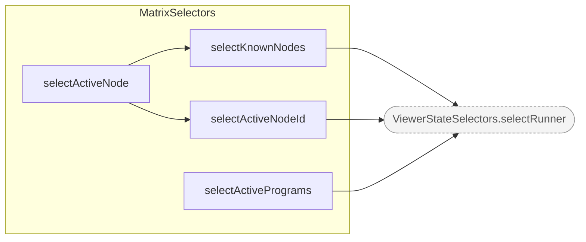

### HouseRulesSelectors

`src/state/runner/houseRules/houseRules.selector.ts`

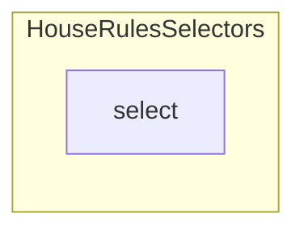

### InitiativeSelectors

`src/state/runner/initiative/initiative.selector.ts`

```mermaid
flowchart LR
  subgraph s_InitiativeSelectors["InitiativeSelectors"]
    n155["selectPassesCompleted"]
    n156["selectRolledResults"]
    n157["selectGoingFirst"]
    n158["selectExtraPasses"]
  end
  n92(["ViewerStateSelectors.selectRunner"]):::external
  n155 --> n92
  n156 --> n92
  n157 --> n92
  n158 --> n92
  classDef external fill:#f4f4f4,stroke:#999,stroke-dasharray:3 3,color:#555
```

### ItemSelectors

`src/state/runner/items/items.selector.ts`

```mermaid
flowchart LR
  subgraph s_ItemSelectors["ItemSelectors"]
    n120["selectAll"]
    n121["selectCatalog"]
    n122["selectCatalogTree"]
    n123["selectByFilter"]
    n124["selectOnHand"]
    n125["selectActive"]
    n126["selectStashed"]
    n127["selectById"]
    n128["selectByType"]
    n129["selectChildrenOf"]
    n130["selectChildListOf"]
  end
  subgraph s_ItemSelectors_Armor["ItemSelectors.Armor"]
    n131["selectById"]
    n132["selectAll"]
    n133["selectEquipped"]
    n134["selectTotal"]
    n135["selectBulk"]
    n136["selectEffective"]
  end
  subgraph s_ItemSelectors_Armor_DiceGroups["ItemSelectors.Armor.DiceGroups"]
    n137["selectArmor"]
  end
  subgraph s_ItemSelectors_Implants["ItemSelectors.Implants"]
    n138["selectById"]
    n139["selectImplanted"]
  end
  subgraph s_ItemSelectors_Software["ItemSelectors.Software"]
    n140["selectById"]
  end
  subgraph s_ItemSelectors_Vehicles["ItemSelectors.Vehicles"]
    n141["selectById"]
  end
  subgraph s_ItemSelectors_Weapons["ItemSelectors.Weapons"]
    n142["selectById"]
  end
  subgraph s_ItemSelectors_Devices["ItemSelectors.Devices"]
    n143["selectById"]
  end
  subgraph s_ItemSelectors_Matrix["ItemSelectors.Matrix"]
    n144["selectStats"]
  end
  subgraph s_ItemSelectors_FirearmAccessories["ItemSelectors.FirearmAccessories"]
    n145["selectById"]
  end
  subgraph s_ItemSelectors_Sins["ItemSelectors.Sins"]
    n146["selectById"]
  end
  subgraph s_ItemSelectors_Credsticks["ItemSelectors.Credsticks"]
    n147["selectById"]
  end
  subgraph s_ItemSelectors_Programs["ItemSelectors.Programs"]
    n148["selectById"]
  end
  subgraph s_ItemSelectors_Other["ItemSelectors.Other"]
    n149["selectById"]
  end
  subgraph s_ItemSelectors_Licenses["ItemSelectors.Licenses"]
    n150["selectById"]
    n151["selectForItem"]
    n152["selectItemsForId"]
  end
  n94(["ViewerStateSelectors.selectItems"]):::external
  n120 --> n94
  n121 --> n94
  n122 --> n94
  n123 --> n94
  n124 --> n94
  n125 --> n94
  n126 --> n94
  n127 --> n94
  n128 --> n94
  n129 --> n94
  n130 --> n129
  n131 --> n94
  n132 --> n94
  n133 --> n132
  n134 --> n133
  n135 --> n133
  n136 --> n133
  n137 --> n136
  n138 --> n94
  n139 --> n94
  n140 --> n94
  n141 --> n94
  n142 --> n94
  n143 --> n94
  n144 --> n127
  n145 --> n94
  n146 --> n94
  n147 --> n94
  n148 --> n94
  n149 --> n94
  n150 --> n94
  n151 --> n94
  n152 --> n94
  classDef external fill:#f4f4f4,stroke:#999,stroke-dasharray:3 3,color:#555
```

### KarmaSelectors

`src/state/runner/karma/karma.selector.ts`

```mermaid
flowchart LR
  subgraph s_KarmaSelectors["KarmaSelectors"]
    n99["select"]
    n100["selectCurrent"]
    n101["selectLog"]
    n102["selectTotal"]
  end
  n92(["ViewerStateSelectors.selectRunner"]):::external
  n99 --> n92
  n100 --> n99
  n101 --> n99
  n102 --> n99
  classDef external fill:#f4f4f4,stroke:#999,stroke-dasharray:3 3,color:#555
```

### LifestyleSelectors

`src/state/runner/lifestyle/lifestyle.selector.ts`

```mermaid
flowchart LR
  subgraph s_LifestyleSelectors["LifestyleSelectors"]
    n193["select"]
    n194["selectName"]
    n195["selectUpkeep"]
    n196["selectMonthsPaid"]
    n197["selectNotes"]
    n198["selectStandardType"]
    n199["selectStartingNuyenType"]
    n200["selectPrepaidCost"]
  end
  n92(["ViewerStateSelectors.selectRunner"]):::external
  n193 --> n92
  n194 --> n193
  n195 --> n193
  n196 --> n193
  n197 --> n193
  n198 --> n193
  n199 --> n193
  n200 --> n193
  classDef external fill:#f4f4f4,stroke:#999,stroke-dasharray:3 3,color:#555
```

### MetaSelectors

`src/state/runner/meta/meta.selector.ts`

```mermaid
flowchart LR
  subgraph s_MetaSelectors["MetaSelectors"]
    n159["selectLastExportDate"]
  end
  n92(["ViewerStateSelectors.selectRunner"]):::external
  n159 --> n92
  classDef external fill:#f4f4f4,stroke:#999,stroke-dasharray:3 3,color:#555
```

### NotesSelectors

`src/state/runner/notes/notes.selector.ts`

```mermaid
flowchart LR
  subgraph s_NotesSelectors["NotesSelectors"]
    n103["select"]
  end
  n92(["ViewerStateSelectors.selectRunner"]):::external
  n103 --> n92
  classDef external fill:#f4f4f4,stroke:#999,stroke-dasharray:3 3,color:#555
```

### NuyenSelectors

`src/state/runner/nuyen/nuyen.selector.ts`

```mermaid
flowchart LR
  subgraph s_NuyenSelectors["NuyenSelectors"]
    n169["select"]
    n170["selectAmount"]
    n171["selectLoans"]
  end
  n92(["ViewerStateSelectors.selectRunner"]):::external
  n169 --> n92
  n170 --> n169
  n171 --> n169
  classDef external fill:#f4f4f4,stroke:#999,stroke-dasharray:3 3,color:#555
```

### PowersSelectors

`src/state/runner/powers/powers.selector.ts`

```mermaid
flowchart LR
  subgraph s_PowersSelectors["PowersSelectors"]
    n172["selectAll"]
    n173["selectUsed"]
  end
  n92(["ViewerStateSelectors.selectRunner"]):::external
  n172 --> n92
  n173 --> n172
  classDef external fill:#f4f4f4,stroke:#999,stroke-dasharray:3 3,color:#555
```

### ProfileSelectors

`src/state/runner/profile/profile.selector.ts`

```mermaid
flowchart LR
  subgraph s_ProfileSelectors["ProfileSelectors"]
    n95["select"]
    n96["selectName"]
    n97["selectAlias"]
    n98["selectDisplayName"]
  end
  n92(["ViewerStateSelectors.selectRunner"]):::external
  n95 --> n92
  n96 --> n95
  n97 --> n95
  n98 --> n97
  n98 --> n96
  classDef external fill:#f4f4f4,stroke:#999,stroke-dasharray:3 3,color:#555
```

### QualitiesSelectors

`src/state/runner/qualities/qualities.selector.ts`

```mermaid
flowchart LR
  subgraph s_QualitiesSelectors["QualitiesSelectors"]
    n118["selectAll"]
  end
  n92(["ViewerStateSelectors.selectRunner"]):::external
  n118 --> n92
  classDef external fill:#f4f4f4,stroke:#999,stroke-dasharray:3 3,color:#555
```

### ReputationSelectors

`src/state/runner/reputation/reputation.selector.ts`

```mermaid
flowchart LR
  subgraph s_ReputationSelectors["ReputationSelectors"]
    n110["selectLedger"]
    n111["selectLedgerForType"]
    n112["selectStreetCred"]
    n113["selectNotoriety"]
    n114["selectPublicAwareness"]
    n115["selectPublicAwarenessInfo"]
    n116["selectAll"]
  end
  n92(["ViewerStateSelectors.selectRunner"]):::external
  n102(["KarmaSelectors.selectTotal"]):::external
  n110 --> n92
  n111 --> n92
  n112 --> n102
  n112 --> n111
  n113 --> n111
  n114 --> n112
  n114 --> n113
  n114 --> n110
  n115 --> n114
  n116 --> n112
  n116 --> n113
  n116 --> n114
  classDef external fill:#f4f4f4,stroke:#999,stroke-dasharray:3 3,color:#555
```

### SkillsSelectors

`src/state/runner/skills/skills.selector.ts`

```mermaid
flowchart LR
  subgraph s_SkillsSelectors["SkillsSelectors"]
    n17["selectActiveSkills"]
    n18["selectSkillGroups"]
    n19["selectKnowledgeSkills"]
    n20["selectLanguageSkills"]
    n21["selectAllowedActive"]
    n22["selectRawValue"]
    n23["selectValue"]
    n24["selectModifiers"]
    n25["selectRatingBreakdown"]
    n26["selectRating"]
    n27["selectSpecializationBreakdown"]
    n28["selectSpecialization"]
    n29["selectActiveSkill"]
  end
  subgraph s_SkillsSelectors_DiceGroups["SkillsSelectors.DiceGroups"]
    n30["selectSkill"]
    n31["selectSpecialization"]
    n32["selectSpecializationCovering"]
    n33["selectKnowledgeSkill"]
    n34["selectLanguageSkill"]
  end
  n93(["ViewerStateSelectors.selectEntity"]):::external
  n106(["BiologySelectors.selectAwakening"]):::external
  n202(["SourcedGameEffectSelectors.selectAll"]):::external
  n17 --> n93
  n18 --> n93
  n19 --> n93
  n20 --> n93
  n21 --> n106
  n22 --> n17
  n22 --> n18
  n23 --> n22
  n24 --> n93
  n24 --> n202
  n25 --> n22
  n25 --> n24
  n26 --> n25
  n27 --> n93
  n27 --> n202
  n28 --> n17
  n29 --> n17
  n29 --> n23
  n30 --> n25
  n31 --> n27
  n32 --> n31
  n32 --> n28
  classDef external fill:#f4f4f4,stroke:#999,stroke-dasharray:3 3,color:#555
```

### SpellsSelectors

`src/state/runner/spells/spells.selector.ts`

```mermaid
flowchart LR
  subgraph s_SpellsSelectors["SpellsSelectors"]
    n192["selectAll"]
  end
  n92(["ViewerStateSelectors.selectRunner"]):::external
  n192 --> n92
  classDef external fill:#f4f4f4,stroke:#999,stroke-dasharray:3 3,color:#555
```

### SpiritsSelectors

`src/state/runner/spirits/spirits.selector.ts`

```mermaid
flowchart LR
  subgraph s_SpiritsSelectors["SpiritsSelectors"]
    n154["selectAll"]
  end
  n92(["ViewerStateSelectors.selectRunner"]):::external
  n154 --> n92
  classDef external fill:#f4f4f4,stroke:#999,stroke-dasharray:3 3,color:#555
```

### SpriteSelectors

`src/state/runner/sprites/sprites.selector.ts`

```mermaid
flowchart LR
  subgraph s_SpriteSelectors["SpriteSelectors"]
    n205["selectAll"]
    n206["selectVisible"]
    n207["selectMaxRegistered"]
    n208["selectMaxTasks"]
  end
  n92(["ViewerStateSelectors.selectRunner"]):::external
  n106(["BiologySelectors.selectAwakening"]):::external
  n185(["AttrSelectors.forAttr"]):::external
  n23(["SkillsSelectors.selectValue"]):::external
  n205 --> n92
  n206 --> n106
  n206 --> n205
  n207 --> n185
  n208 --> n23
  n208 --> n185
  classDef external fill:#f4f4f4,stroke:#999,stroke-dasharray:3 3,color:#555
```

### TraditionSelectors

`src/state/runner/tradition/tradition.selector.ts`

```mermaid
flowchart LR
  subgraph s_TraditionSelectors["TraditionSelectors"]
    n119["select"]
  end
  n92(["ViewerStateSelectors.selectRunner"]):::external
  n119 --> n92
  classDef external fill:#f4f4f4,stroke:#999,stroke-dasharray:3 3,color:#555
```

### ViewerStateSelectors

`src/state/runner/viewerSelector.ts`

```mermaid
flowchart LR
  subgraph s_viewerSelector["module scope (not exported from a namespace)"]
    n91["selectEntity"]
  end
  subgraph s_ViewerStateSelectors["ViewerStateSelectors"]
    n92["selectRunner"]
    n93["selectEntity"]
    n94["selectItems"]
  end
  n93 --> n91
```
